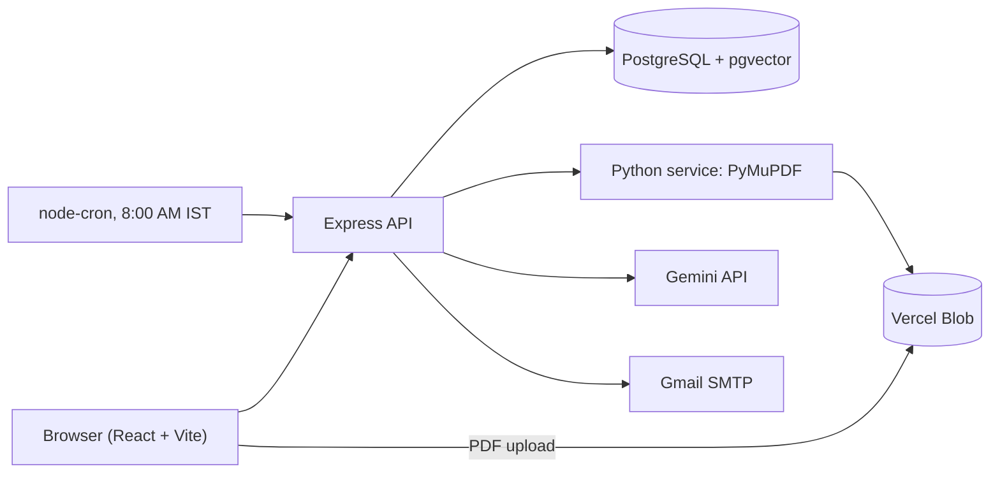
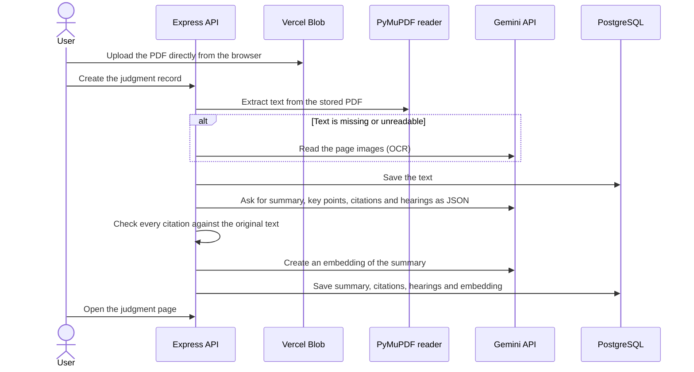
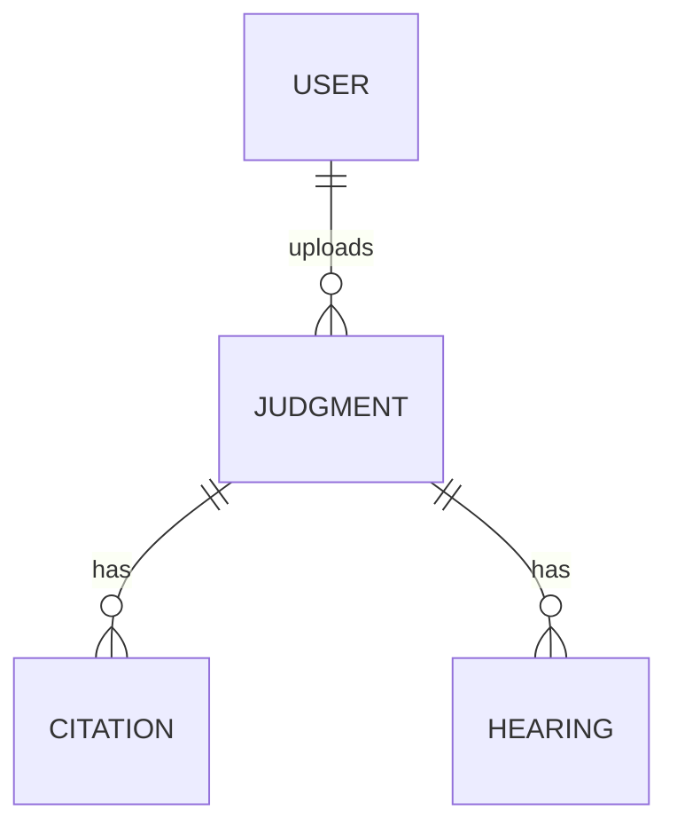

# LexiBrief

**AI-powered legal intelligence and case management for court judgments.**

Lawyers and court officials upload lengthy judgments (English or Hindi, typed or scanned). LexiBrief produces a concise summary, the key legal points and verified citations, finds similar judgments, and keeps track of upcoming hearings with email reminders.

This is the **React (Vite) + Express** edition: a React client in `client/` and a separate Express API in `server/`.

---

## Why this project

A judgment can run to 50 pages or more, and nobody has time to read every one before a hearing. LexiBrief does the first pass: what the case was about, what the court decided, which earlier cases it relied on, which other judgments in the library are related, and when the next hearing is.

## Features

| Area | What it does |
|---|---|
| **Upload** | Drag-and-drop PDF upload straight to cloud storage, with progress, up to 25 MB |
| **Reading PDFs** | Text is extracted with PyMuPDF. Scanned and old-font Hindi PDFs, which have no usable text, are read by AI from the page images |
| **Case summary** | A short summary and a one-line outcome, written in the **same language as the judgment** (Hindi judgment, Hindi summary) |
| **Key legal points** | A numbered list of the issues, the court's reasoning and the directions given |
| **Verified citations** | Citations suggested by the AI are kept only if they appear in the judgment's own text, and a pattern matcher for Indian law-report formats (AIR, SCC, SCR, SCALE, SCC OnLine) finds any the AI missed |
| **Similar judgments** | Related judgments from the user's own library, matched by meaning using embeddings and pgvector, with the citations the two judgments share |
| **Hearings** | Future dates found in a judgment, or added by hand. A Hearings page, a 7-day strip on the dashboard, and a daily email reminder the day before |
| **Search** | Search titles, parties, court, summaries and the full text |
| **Dashboard insights** | Counts, the next 7 days, the most cited authorities across your judgments, and a language breakdown |
| **Judgment page** | At-a-glance stats, a sticky section menu, the outcome up front, and a Retry button when reading a PDF fails |
| **Accounts** | Email-verified sign-up (OTP), password sign-in, and password reset by emailed code |

## How it works



### From upload to summary



### Data model



| Table | Purpose |
|---|---|
| `User` | Account, hashed password, role (Lawyer or Court official), email verification |
| `Judgment` | The PDF link, extracted text, summary, key points, outcome, parties, language, and a 768-number embedding (`vector(768)`) |
| `Citation` | One row per verified citation, with a normalised form used to find shared citations |
| `Hearing` | A date and purpose, plus a marker so each reminder is sent only once |
| `OtpCode` | Hashed one-time codes, tagged `VERIFY` (sign-up) or `RESET` (password reset) |

## Tech stack

| Area | Technology |
|---|---|
| Frontend | React 19, Vite, React Router, Tailwind CSS 4 |
| Backend | Node.js, Express 5 |
| Database | PostgreSQL (Neon), Prisma ORM, pgvector |
| Authentication | JWT in an httpOnly cookie, bcrypt, email OTP |
| PDF reading | Python and PyMuPDF, run as a small separate service |
| AI | Google Gemini API: summaries, OCR and embeddings |
| File storage | Vercel Blob |
| Email | Nodemailer with Gmail SMTP |
| Scheduling | node-cron inside the server |

## Getting started

### Requirements

- Node.js 20 or newer
- Python 3.10 or newer
- A Postgres database with the `vector` extension (Neon and Supabase both have it)
- A Gemini API key from [Google AI Studio](https://aistudio.google.com)
- A Gmail account with 2-Step Verification and an App Password, for sending emails
- A Vercel Blob store with **public** access

### Run it locally

Use three terminals.

```bash
# 1. API
cd server
cp .env.example .env          # on Windows: copy .env.example .env
# fill in .env (see the table below)
npm install
npx prisma migrate deploy     # creates the tables and enables pgvector
npm run dev                   # http://localhost:4000

# 2. PDF extractor
cd server
pip install -r extractor/requirements.txt
npm run extractor             # http://127.0.0.1:8000

# 3. React app
cd client
npm install
npm run dev                   # http://localhost:5173
```

Open http://localhost:5173. In development Vite forwards `/api` to the Express server, so cookies work without any CORS setup.

If `GMAIL_USER` is empty and `NODE_ENV` is not `production`, emailed codes are printed in the API terminal instead of being sent, which is handy for testing.

### Environment variables

Copy `server/.env.example` to `server/.env` and fill in the values. Never commit `.env`.

| Variable | Purpose |
|---|---|
| `DATABASE_URL` | Postgres connection string (with pooling if your host offers it) |
| `DIRECT_URL` | Connection string without pooling, used for migrations |
| `AUTH_SECRET` | Random secret for sessions and hashing one-time codes |
| `PORT` | API port, default `4000` |
| `APP_URL` | Public address of the site, used in reminder emails |
| `GMAIL_USER` | Gmail address that sends the emails |
| `GMAIL_APP_PASSWORD` | 16-character Google App Password, without spaces |
| `BLOB_READ_WRITE_TOKEN` | Token of your **public** Vercel Blob store |
| `EXTRACT_URL` | Address of the Python reader, locally `http://127.0.0.1:8000` |
| `EXTRACT_SECRET` | Shared secret between the API and the Python reader (same value in both) |
| `GEMINI_API_KEY` | Google Gemini API key |
| `GEMINI_MODEL` | Main model for summaries and reading scanned pages |
| `GEMINI_FALLBACK_MODEL` | Backup model used when the main one is busy |
| `GEMINI_EMBED_MODEL` | Embedding model, for example `gemini-embedding-001` |
| `ENABLE_CRON` | Set to `false` to turn off the built-in 8:00 AM IST reminder job |
| `CRON_SECRET` | Secret for `GET /api/cron/reminders`, if you use an outside scheduler |

Generate a secret with:

```bash
node -e "console.log(require('crypto').randomBytes(32).toString('hex'))"
```

Model names change over time. If you see "model not found", check the current names in Google AI Studio and update the variables. No code changes are needed.

## Project structure

```
.github/                   CI workflow and pull request template
client/
  src/
    pages/                 Landing, Login, Register, ForgotPassword, Dashboard,
                           Judgments, JudgmentDetail, Upload, Hearings
    components/            shared interface pieces (Sidebar, Field, Icon, ...)
    context/AuthContext    signed-in user
    lib/                   api, useFetch, validate, format, ist
server/
  src/
    index.js               Express app, static client, cron job
    routes/                auth, otp, blob, judgments, hearings, dashboard, cron
    lib/                   prisma, otp, mailer, gemini, summarize, citations,
                           embed, ocr, extract, textcheck, ist, blob, reminders
    middleware/auth.js     JWT cookie check
  prisma/                  schema.prisma and migrations/
  extractor/extract.py     PyMuPDF reader
render.yaml                one-click deploy blueprint for Render
CONTRIBUTING.md  LICENSE  .editorconfig  .nvmrc
```

### Main endpoints

| Endpoint | Purpose |
|---|---|
| `POST /api/auth/register`, `/login`, `/logout`, `GET /api/auth/me` | Account and session |
| `POST /api/otp/send`, `/api/otp/verify` | Sign-up email verification |
| `POST /api/auth/forgot-password` | Email a 6-digit reset code |
| `POST /api/auth/reset-password` | Set a new password using `{ email, otp, password }` |
| `POST /api/blob/upload` | Issues a short-lived upload permission to the browser |
| `GET /api/dashboard` | Stats, recent judgments, 7-day strip, top citations, languages |
| `GET`, `POST /api/judgments` | Search list and create |
| `GET`, `DELETE /api/judgments/:id` | Detail and delete |
| `POST /api/judgments/:id/process` | Extracts text, with AI reading as a fallback (also used by Retry) |
| `POST /api/judgments/:id/summarize` | Summary, key points, verified citations, hearings, embedding |
| `GET /api/judgments/:id/similar` | Similar judgments (pgvector) |
| `POST /api/judgments/embed-missing` | Creates embeddings for judgments that lack one |
| `POST /api/judgments/:id/hearings` | Add a hearing |
| `GET /api/hearings`, `PATCH`, `DELETE /api/hearings/:hearingId` | List, edit and remove hearings |
| `GET /api/cron/reminders` | Sends next-day hearing reminders (secret required) |

## Production

```bash
cd client && npm run build            # creates client/dist
cd ../server && NODE_ENV=production npm start
```

When `client/dist` exists, Express serves it too, so the whole app runs from one address. Set `APP_URL` to that address, run the Python reader as its own service, and keep `EXTRACT_SECRET` the same in both. The included `render.yaml` sets up both services on [Render](https://render.com) (New, then Blueprint, then pick this repository). By hand, the setup is:

1. **Extractor service:** root `server/extractor`, build `pip install -r requirements.txt`, start `python extract.py`.
2. **Main service:** build `cd client && npm install && npm run build && cd ../server && npm install && npx prisma migrate deploy`, start `cd server && npm start`.
3. Add the environment variables above, with `NODE_ENV=production`, `APP_URL` and `EXTRACT_URL` set to the real addresses.

## Screen sizes

The interface is built mobile first and checked from about 320 px wide up to large desktops:

- Below 1024 px the sidebar becomes a top bar with a menu; the judgment page's section menu scrolls sideways.
- Form fields use 16 px text on phones so iOS does not zoom in, and buttons get 44 px tap targets on touch screens.
- Long case names and citations wrap instead of widening the page.

## Contributing

See [CONTRIBUTING.md](CONTRIBUTING.md). The project is released under the [MIT License](LICENSE).

## Security notes

- Passwords are stored as bcrypt hashes. One-time codes are stored as HMAC hashes, expire after 10 minutes, and allow 5 attempts. A 60-second wait applies between code requests.
- Password-reset codes and sign-up codes are kept apart (`RESET` and `VERIFY`), so one can never be used for the other.
- The forgot-password and sign-up code requests answer the same way whether or not an email is registered.
- Sign-in uses an httpOnly cookie. Every data route checks the signed-in user, and each user can only see their own judgments, summaries and hearings.
- The Python reader needs a secret header.
- The reminder endpoint needs a secret that only the scheduler holds.
- Citations from the AI are checked against the source text before they are shown.

## Limitations

- **Summaries are AI-generated.** They must be checked against the original judgment. Every summary page says so.
- **Privacy:** judgments are sent to Google's Gemini API for summaries and for reading scanned pages. Do not upload confidential documents on free-tier keys.
- **Scanned PDFs:** AI reading covers the first 40 pages.
- **Very long judgments:** the summary is based on the first and last parts of the text, and the middle is dropped once a judgment is very long. Citations are still checked against the full text.
- **Free-tier limits:** AI requests are rate limited, and Google's servers are sometimes busy. The app retries and falls back to a second model, and failed readings can be retried from the judgment page.
- **Similar judgments** compare only the signed-in user's own uploads.
- **Language:** the AI-written content follows the judgment's language, but menus and labels are in English.
- **Sessions:** after a password reset, sessions already open on other devices stay signed in until they expire.
- **Sleeping hosts:** on free hosting plans the server can sleep, which delays the first request and pauses the 8:00 AM reminder job.

## Built with

[React](https://react.dev), [Vite](https://vite.dev), [Express](https://expressjs.com), [Tailwind CSS](https://tailwindcss.com), [Prisma](https://www.prisma.io), [Neon](https://neon.tech), [pgvector](https://github.com/pgvector/pgvector), [PyMuPDF](https://pymupdf.readthedocs.io) and [Google Gemini](https://ai.google.dev).

## About

An educational project, not legal advice.
